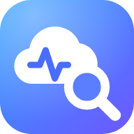

<div align="center">



# 📚 Azure Local Compendium

Find help for [Azure Local](https://learn.microsoft.com/azure/azure-local/) errors in one place.
Search troubleshooting guides, known issues, and release notes.

**[🌐 Open knowledge.azl.graa.dev](https://knowledge.azl.graa.dev)**

[](package.json)
[](https://github.com/erikgraa/azure-local-knowledge/actions/workflows/ci.yml)
[](LICENSE)

</div>

## 🔎 Find a fix

1. Paste an error or describe the problem.
2. Pick your Azure Local release to narrow the results.
3. Open a result and check the linked official guide before applying a fix.


## 🏠 Self-host it

Run your own copy with Docker:

```bash
docker run --rm -p 8080:8080 ghcr.io/erikgraa/azure-local-knowledge:latest
```

Open **[localhost:8080](http://localhost:8080)**. Prefer Podman? Replace `docker` with `podman`.

The image includes an **offline knowledge snapshot**: searching works without internet access, but linked official guides still need it. It does not refresh itself; pull a newer image and recreate the container to update the snapshot.

See the [self-hosting guide](docs/self-hosting.md) for Podman setup, automatic updates, and pinned snapshots.

## 📖 Learn more

| Guide | What's inside |
| --- | --- |
| [Using search](docs/usage.md) | Features, screenshots, keyboard shortcuts, and shareable URLs |
| [Self-hosting](docs/self-hosting.md) | Docker, Podman, offline use, updates, and image retention |
| [PowerShell](docs/powershell.md) | Search from the command line |
| [Development](docs/development.md) | Run locally, build, test, and configure |
| [How it works](docs/how-it-works.md) | Sources, parsing, data schema, AI enrichment, safety, and knowledge retention |
| [Deployment](docs/deployment.md) | GitHub Pages, CI/CD, permissions, and setup |
| [Project notes](docs/project-notes.md) | Project layout, limitations, credits, and licensing |

> ⚠️ **Unofficial community tool.** Not affiliated with, endorsed by, or sponsored by Microsoft. Azure and Azure Local are trademarks of Microsoft Corporation. Summaries may be AI-generated and inaccurate: always confirm fixes in the linked source (GitHub troubleshooting guide / Microsoft Learn) before acting on a production cluster.

Code: [MIT](LICENSE). Troubleshooting content: Microsoft and contributors; see [credits](docs/project-notes.md#credits) and [NOTICE.md](NOTICE.md).
