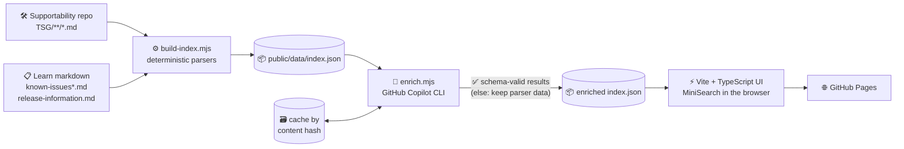

# How it works

[← README](../README.md)

- [🏗️ How it works](#architecture)
- [🧩 The index](#index)
- [🔬 How parsing works](#parsing)
- [🤖 Copilot enrichment](#copilot-enrichment)
- [🛡️ Guardrails: never ship an empty site](#guardrails)
- [🗄️ Nothing is ever removed](#knowledge-retention)

<a id="architecture"></a>

## 🏗️ How it works



1. **Fetch** – the Git trees API lists `TSG/**/*.md`; markdown is pulled from `raw.githubusercontent.com`. Learn pages are *not* scraped: the build reads the source markdown from [`MicrosoftDocs/azure-stack-docs`](https://github.com/MicrosoftDocs/azure-stack-docs/tree/main/azure-local).
2. **Parse** – defensive, regex/heuristic parsers (details below) turn each document into normalized records. Unknown fields stay `null`/`[]`, never guessed.
3. **Enrich (optional)** – Copilot reviews new/changed items only and refines the fields parsers can't reliably get.
4. **Search** – the browser downloads one `index.json` and builds a MiniSearch index in a few milliseconds.

<a id="index"></a>

## 🧩 The index

`public/data/index.json` (git-ignored, generated) is validated against [`schema/index.schema.json`](../schema/index.schema.json).

```jsonc
{
  "schemaVersion": 1,
  "generatedAt": "2026-10-31T23:54:37Z",
  "sources": [ /* repo + Learn pages, counts */ ],
  "releases": [ { "id": "2610", "supported": true, "osVersions": ["24H2"], "solutionVersions": [...] } ],
  "items": [ /* records */ ]
}
```

| Field | Meaning |
| --- | --- |
| `id`, `type` | Stable id · `tsg` \| `known-issue` \| `release` |
| `title`, `area`, `subarea` | Clean title (e.g. `Missing SPN during deployment`) and a canonical area (*Deployment*, *Update & SBE*, *Networking*…) |
| `status` | Known issues: `open` \| `fixed` \| `expected` |
| `releases[]` | Affected release trains (`2411.3`, `2504`…) – from Learn tables, TSG titles, or Copilot |
| `osVersions[]`, `solutionVersions[]`, `versionText` | `23H2`/`24H2`, e.g. `10.2411.3.2`, raw title metadata |
| `introducedIn`, `fixedIn` | First release listing the issue · release whose “Fixed issues” table lists it |
| `symptoms`, `symptomSummary` | Parsed text · one-line Copilot summary |
| `errorStrings[]` | Error text from code fences / “Error” sections / inline code |
| `errorCodes[]` | Exception names, `0x` codes, exit codes, validator names |
| `aliases[]` | 🤖 Normalized error strings and search phrases |
| `mitigation`, `mitigationSummary` | Parsed text · short summary |
| `url`, `urls[]` | Deep link to the TSG on GitHub / the Learn section |
| `lastUpdated`, `sourceHash` | Last commit date (TSGs) or `ms.date` · SHA-256 of the source (cache key) |
| `related[]`, `flags[]` | Cross-links (parser + Copilot) · inconsistencies |
| `enrichment` | Provenance of Copilot-derived fields (`null` if none) |

<a id="parsing"></a>

## 🔬 How parsing works

### 🛠️ TSG markdown (`scripts/lib/tsg.mjs`)

- **Title** – first non-boilerplate H1 (skips *Table of contents* / *Revision History*); otherwise the label from the folder `README.md` index, otherwise the file name. Titles like `TSG | 23H2 | 10.2411.3.2 | Missing SPN` are split into clean title + version metadata.
- **Versions** – release trains (`2411.3`), solution versions (`10.2411.3.2`) and `23H2/24H2` from the title/file name (supports `2411-1`, ranges, “and later”). Resolved against the real release list from Learn.
- **Symptoms / mitigation** – sections named *Symptoms, Issue, Problem…* and *Mitigation, Resolution, Workaround…*.
- **Error text** – fenced blocks that aren't commands, prose under *Error*/*Exception*/*Message* headings, and inline code in the symptoms. Exception names, hex/exit codes and `tsg-metadata` validator names become `errorCodes`.
- **Area** – the `TSG/<Area>/` folder, mapped to a canonical area shared with Learn's *Feature* column.
- **Excluded** – READMEs, images, contribution templates.

### 📋 Learn markdown (`scripts/lib/learn.mjs`)

- Walks `known-issues.md`, `previous-releases/known-issues-2x.md` (discovered via the contents API) tracking `::: moniker` ranges and `## Known issues for version …` headings.
- Reads every *Fixed issues*, *Known issues*, *Known issues from previous releases* and *Known and expected behaviors* table (columns detected by header).
- **De-duplicates** the same carried-over row across dozens of releases by Microsoft bug id (`<!--33008717-->`) or a text hash → one record with every affected release, `introducedIn` and `fixedIn`.
- Flags oddities, e.g. an issue still listed after the release that fixed it.
- **Release info** – `release-information-23h2.md` tables → trains, solution versions, OS builds, availability dates, supported window.
- **Deep links** – `…/known-issues?view=azloc-2610#known-issues-for-version-2610`, with Learn's heading-anchor rules (dots removed).
- Cross-links known issues ⇄ TSGs when a Learn row cites a TSG URL.

<a id="copilot-enrichment"></a>

## 🤖 Copilot enrichment

The daily workflow runs `npm run enrich` after `build:index`. It **never** replaces parsed text — it adds:

| ✅ Fills / corrects | How |
| --- | --- |
| 📅 Affected version ranges | Expanded onto real release trains; fills gaps, extends only with *high* confidence, otherwise **flags** a mismatch |
| 🧷 Error aliases & normalized errors | GUIDs/hosts/paths replaced by placeholders so pasted errors match |
| 📝 One-line symptom + mitigation summaries | Max 200 / 340 characters |
| 🔗 Cross-links | Only ids from a lexically-nearest candidate list; made symmetric |
| 🚩 Inconsistency flags | `version-mismatch`, `inconsistent`, `duplicate`, `stale`, `broken-link`, `unclear` |

**Guard rails**

- 🗃️ **Cached by content hash** (`.cache/enrichment-cache.json`, keyed by `sourceHash` + prompt version) → only new/changed items are re-processed. In CI the cache is persisted with `actions/cache`.
- 🧪 **Schema-validated** against [`schema/enrichment.schema.json`](../schema/enrichment.schema.json); over-long strings are clamped, bad structure is rejected, unknown ids are dropped.
- 🛟 **Always falls back** to deterministic data: no secret, CLI error, invalid JSON, schema failure or timeout never fails the deploy (use `--strict` to make it fail).
- 🔒 **Sandboxed**: the Copilot CLI runs with `--deny-tool=shell --deny-tool=write`, in an empty temp dir, source text is marked *untrusted* in the prompt. It's pure text-in/text-out.
- 📊 **Budgeted**: `ENRICH_MAX_ITEMS` per run (default 60, TSGs and open issues first), so the backlog is processed over a few days. Each item is enriched **once** (cached by content hash), so cost is bounded by the backlog plus whatever changes upstream.
- 💸 **Pushes never spend Copilot calls**: deploys triggered by a push to `main` only re-publish using the cached enrichment. New enrichment runs on the **daily schedule** and via **Run workflow** (`max_items`, e.g. `300` to clear a backlog in one go). Bumping `PROMPT_VERSION` re-enriches everything on purpose.
- 📋 The run's **step summary** lists everything the model flagged.

<a id="enrichment-authentication"></a>

### 🔑 Required secret & permissions

Pick **one** way to authenticate the Copilot CLI in Actions:

| Option | Setup | Best for |
| --- | --- | --- |
| 🅰️ **PAT secret** *(works everywhere)* | Create a **fine-grained personal access token** with the **“Copilot Requests”** permission from an account with an active **GitHub Copilot** seat, then add it as repository secret **`COPILOT_GITHUB_TOKEN`** (*Settings → Secrets and variables → Actions → Secrets*). Classic PATs (`ghp_…`) are not supported. | Personal repos, forks, anywhere |
| 🅱️ **Built-in `GITHUB_TOKEN`** *(no secret)* | Add repository **variable `COPILOT_USE_GITHUB_TOKEN` = `true`** (*… → Variables*). The workflow already requests `copilot-requests: write`. The organization must allow **“Copilot CLI billed to the organization”** (on by default when Copilot CLI is enabled). | Organization-owned repos |

If neither is configured the enrichment step is **skipped** (with a notice) and parser-only data is published.

| Also | Where | Notes |
| --- | --- | --- |
| `ENRICH_MODEL` *(optional)* | Actions **Variables** | Model name passed to `copilot --model`; defaults to the CLI's default. |
| Workflow permissions | `deploy.yml` | `contents: read`, `pages: write`, `id-token: write`, `copilot-requests: write` – nothing else. |
| Triggers | `deploy.yml` | Only `push`, `schedule`, `workflow_dispatch` – never fork pull requests – so untrusted code can't reach the Copilot credentials. |

> 💡 `ENRICH_PROVIDER=github-models` is also supported by the script (GitHub Models with `GITHUB_TOKEN` + `models: read`) – not wired into the workflow by default.

<a id="guardrails"></a>

## 🛡️ Guardrails: never ship an empty site

The deploy runs against live sources every day, so it is built to survive them being down, rate-limited or reorganised.

| Situation | What happens |
| --- | --- |
| GitHub (TSGs) or Learn is **unreachable** / returns an error | That source's records are carried over from the **last published index** (fetched from the live site at the start of the run). Everything else still refreshes. |
| A source "works" but comes back **suspiciously small** (e.g. the layout changed and almost nothing parses) | Judged against the last published index (default: must keep ≥ 70 % of the guides and known issues, ≥ 80 % of the releases). Below that it is treated as broken and replaced by the last good copy. |
| **No previous index** exists (first deploy) and a source is unusable | The build **fails** with a clear error, so nothing is published. Absolute floors apply: 50 guides, 100 known issues, 15 releases. |
| Data stays stale for **14+ days** | The run fails loudly so someone looks (a failed deploy never replaces the live site). |
| Anything else goes wrong later (enrichment, build) | `check-index` verifies the index schema and minimum sizes before **and** after the Vite build; failure aborts the deploy and the old site stays up. |

When a source is served from cache, the index carries a `degraded` entry (source, since when, why). The site then shows a **“could not be refreshed”** banner, the run emits a warning annotation, and the job summary lists what happened.

Tuning (environment variables): `AZL_MIN_TSG`, `AZL_MIN_KNOWN_ISSUES`, `AZL_MIN_RELEASES`, `AZL_MIN_RATIO` (default `0.7`), `AZL_MAX_STALE_DAYS` (default `14`), `AZL_BASELINE_FILE` (default `.cache/last-good-index.json`). Fixture builds (`--fixtures`) skip these checks.

<a id="knowledge-retention"></a>

## 🗄️ Nothing is ever removed

The official sources change: guides get renamed or deleted, Learn pages are reorganised, old releases drop out of the tables. This project is an **archive**, not a mirror.

- 🏷️ **Removed upstream ≠ removed here.** An item that was in the previous index but is missing from a fresh build is **kept**, marked `lifecycle.state = "removed"` with `firstSeen`, `lastSeen` and `removedAt`. In the UI it shows a dashed *Removed from source* badge, a note with the dates, and (for guides) a **file history** link that still works after deletion. Removed items stay searchable but rank below live ones.
- ♻️ **Reappearing is handled.** If an item comes back it simply turns active again and keeps its original `firstSeen`.
- 🚂 **Release trains too.** A train that disappears from the release tables stays in the release list, flagged as removed.
- 🧱 **A durable archive on a `data` branch.** After every verified build the workflow commits the final `index.json` to the `data` branch (only when the content changed, so history stays small). It survives cache eviction and an unreachable website, keeps the complete history of every daily change, and is the baseline the next build merges against. Pushing to `data` never triggers a deploy, and CI ignores it. The step is `continue-on-error`, so a failed archive push never blocks a deploy.
- 🔢 **Guardrails stay honest.** The shrink checks compare *live* items only, so archived items can't hide a broken source (and a source dropping 40 % of its pages can't silently delete anything).

Good to know: items are matched by id (a guide's path; a known issue's Microsoft bug id, or a hash of its text when it has none). A guide that is **renamed** therefore appears as a new item with the old one archived, and a known issue **without a bug id whose text is edited** can leave its previous wording archived next to the new one.

Restore or inspect the archive any time: `git fetch origin data && git show origin/data:index.json`.
