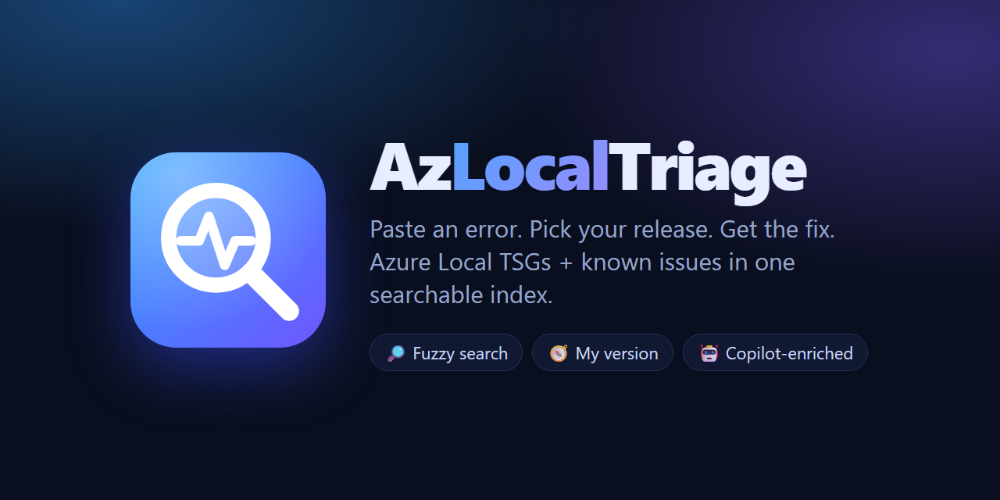
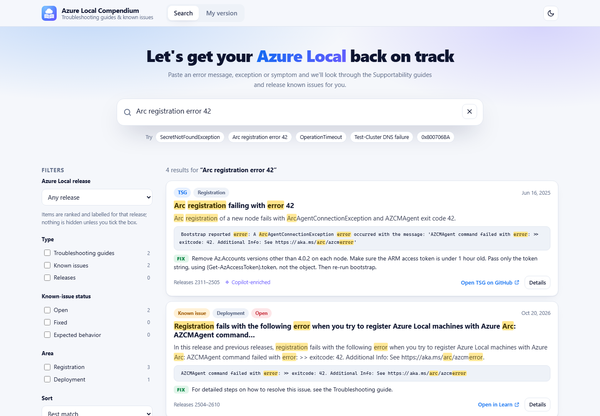
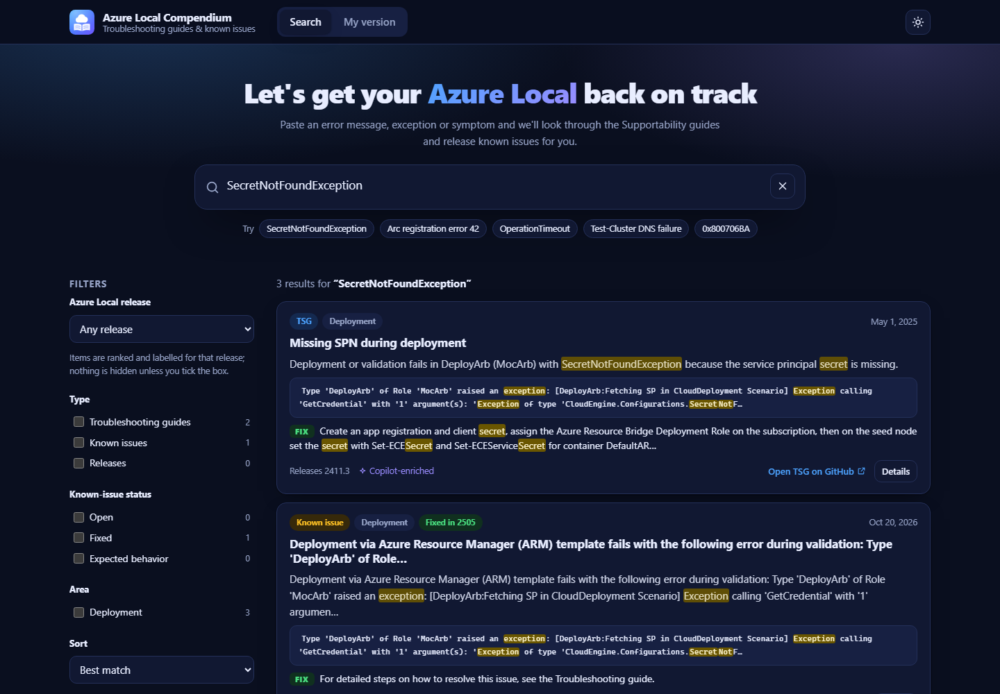
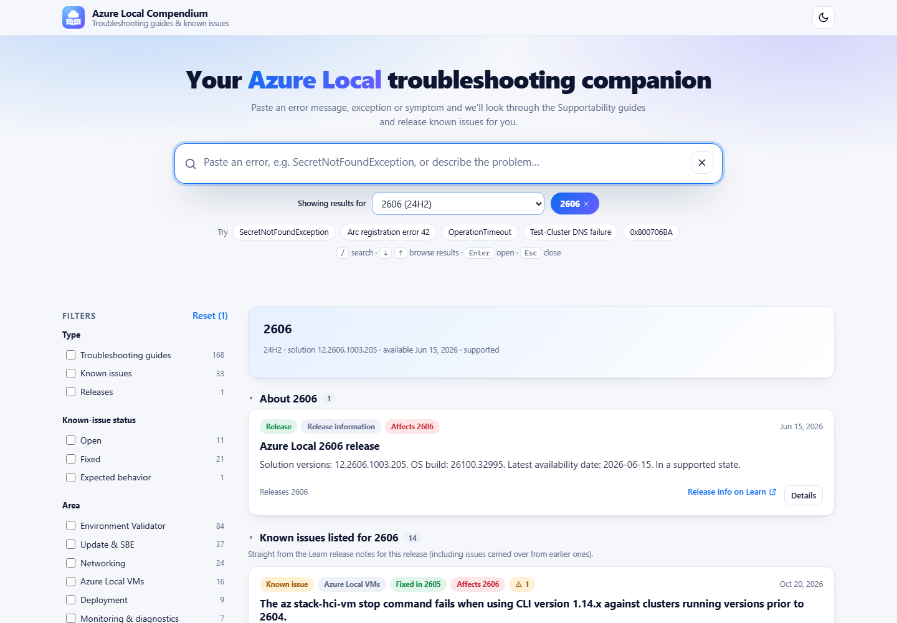
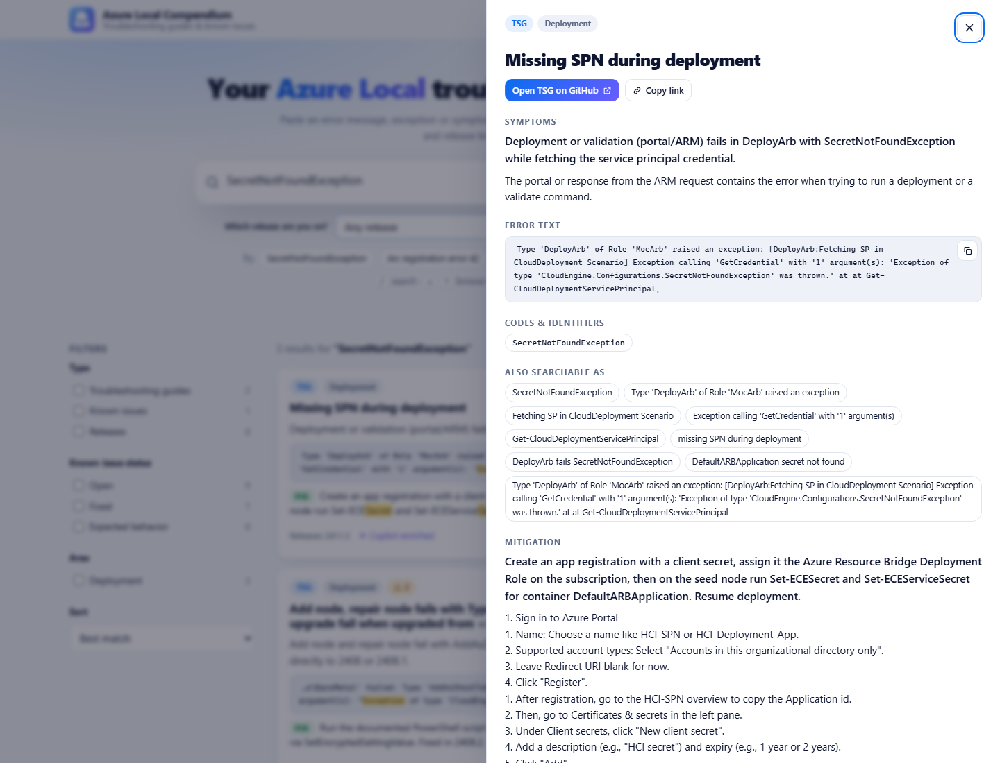

# Search and browser reference

[← README](../README.md)

**One searchable place for troubleshooting [Azure Local](https://learn.microsoft.com/azure/azure-local/).**
Supportability TSGs 🛠️ + release known issues 📋 + release information 🏷️ — merged, normalized, and searchable in your browser.

- [🧭 Why?](#why)
- [✨ Features](#features)
- [📸 Screenshots](#screenshots)
- [🔗 URL parameters](#url-parameters)

## 🧭 Why?

Troubleshooting Azure Local means hopping between two places:

| 📚 Source | What you find there |
| --- | --- |
| 🛠️ [**Azure/AzureLocal-Supportability**](https://github.com/Azure/AzureLocal-Supportability) | Hundreds of troubleshooting guides (TSGs) – symptoms, error text, mitigations |
| 📋 [**Azure Local release notes**](https://learn.microsoft.com/azure/azure-local/known-issues) | Fixed / known issues and the OS/solution builds for every release (2411 → 2610…) |

**Azure Local Compendium** crawls both, normalizes them into one JSON index, and ships a fast static UI: paste the error you're staring at, pick your release, get the matching guide and the known issue that explains it.

## ✨ Features

| | |
| --- | --- |
| 🔎 **Paste-an-error search** | Fuzzy, typo-tolerant full-text search (MiniSearch) that understands `SecretNotFoundException`, `0x800706BA`, `exitcode: 42`, and whole pasted log lines (GUIDs, IPs and timestamps are stripped before matching). |
| 🧭 **Release picker** | Choose your release under the search box and see only what applies to it (a grouped overview when nothing is typed, one ranked list when searching): issues *listed for it*, guides *written for it*, guides that *don't state a release*, and issues *fixed in the next two releases* (so upgrading is the fix). Matches that are documented only for other releases are hidden, with a one-click “Show them” so a search is never a dead end. |
| 🎛️ **Filters** | Release/version · area · type (TSG / known issue / release) · known-issue status (open / fixed / expected). |
| 🧾 **Result cards + detail drawer** | Symptoms, error text (copy button), mitigation snippet, affected releases, related items, and deep links to the **GitHub TSG** or the **Learn known-issue section**. |
| 🔗 **Shareable URLs** | Every search, filter, release and open item lives in the query string. |
| 🌗 **Dark / light** | Follows your OS, remembers your choice, force it with `?theme=dark`. |
| 🤖 **Copilot enrichment** | A daily GitHub Copilot pass fills in what parsers can't: version ranges, error aliases, one-line summaries, cross-links and inconsistency flags — cached, schema-validated, and always falling back to parser data. |
| ⚡ **100 % static** | No backend. Build step → `index.json` → browser search. Hosted on GitHub Pages. |
| 💻 **PowerShell cmdlet** | One file, no module: `Search-AzLocalKnowledge` searches the published index and returns objects (pipe to `ConvertTo-Json`). See [Use it from the command line](powershell.md#command-line). |
| 🐳 **Container image** | The built site with the nightly index baked in, rebuilt after every nightly index and published to GHCR. Runs offline. See [Run it as a container](self-hosting.md#containers). |

## 📸 Screenshots

<table>
  <tr>
    <td width="50%"><b>🔎 Search (light)</b> </td>
    <td width="50%"><b>🌙 Search (dark)</b> </td>
  </tr>
  <tr>
    <td><b>🧭 Release overview</b> </td>
    <td><b>🧾 Detail drawer</b> </td>
  </tr>
</table>

## 🔗 URL parameters

| Param | Example | Meaning |
| --- | --- | --- |
| `q` | `?q=SecretNotFoundException` | Search text |
| `v` | `v=2606` | Release train: only items that apply to it are listed |
| `others` | `others=1` | With `v`: also list matches documented only for other releases |
| `type` | `type=tsg~known-issue` | `tsg`, `known-issue`, `release` (`~`-separated) |
| `status` | `status=open` | `open`, `fixed`, `expected` |
| `area` | `area=Networking` | Area names (`~`-separated) |
| `sort` | `sort=updated` | `relevance` (default) or `updated` |
| `id` | `id=tsg-deployment-…` | Open an item's drawer |
| `theme` | `theme=dark` | Force light/dark |

⌨️ **Keyboard:** <kbd>/</kbd> focus search · <kbd>↓</kbd> from the search box (or <kbd>↓</kbd>/<kbd>↑</kbd>/<kbd>j</kbd>/<kbd>k</kbd> on a result) to browse results · <kbd>Enter</kbd> open details · <kbd>Esc</kbd> close. Focus stays inside the details drawer while it is open.
